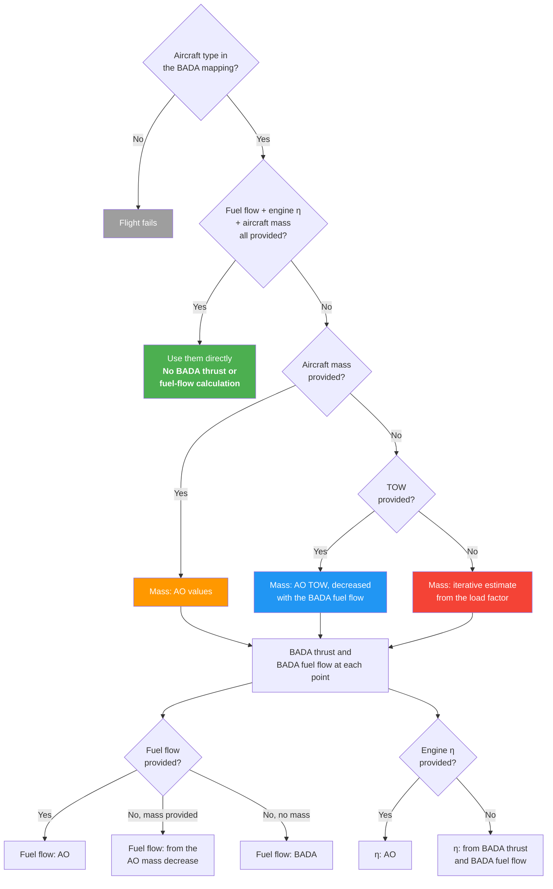

# Input Prioritization

PyNeats follows a **primary-data-first** principle: use aircraft operator (AO) data when available; otherwise, apply conservative secondary defaults.

This page describes the decision logic for determining which performance and fuel inputs are used at each trajectory point.

---

## Data Sources

| Data | Primary (AO-provided) | Secondary (modelled) |
| --- | --- | --- |
| Trajectory | OFP, QAR | FTFM/RTFM, CTFM |
| Fuel flow | Recorded fuel flow, or derived from the recorded mass evolution | BADA estimate |
| Engine efficiency | Recorded η | From BADA thrust and BADA fuel flow |
| Aircraft mass | Mass evolution | Take-off weight decreased along the trajectory with the BADA fuel flow |
| Take-off weight | AO-declared TOW | Iterative estimate: min(MTOW, OEW + load_factor × MPL + 1.15 × trip fuel), see [Mass Estimation](#mass-estimation) |
| Fuel properties | AO-declared (H/C, q_fuel) | Airport fuel file for the departure airport (if configured), then the consortium defaults (q_fuel 42.8 MJ/kg, hydrogen 13.79 wt.%) |
| Engine UID | AO-declared | MRR conservative value |

---

## Performance Input Decision Tree

Each performance quantity has its own source, so the cases are not exclusive: for example, an AO fuel flow can be combined with a BADA aircraft mass. The source of one quantity can still depend on what else is provided, as the tree shows.

| AO provides | BADA calculation | Aircraft mass | Fuel flow | Engine efficiency |
| --- | --- | --- | --- | --- |
| Fuel flow, engine η and aircraft mass | none (see low-speed points below) | AO | AO | AO |
| Aircraft mass, with at most one of fuel flow and engine η | thrust and fuel flow | AO | AO if provided, else from the AO mass decrease | AO if provided, else BADA |
| TOW, no aircraft mass | thrust and fuel flow | AO TOW, decreased with the BADA fuel flow | AO if provided, else BADA | AO if provided, else BADA |
| Neither aircraft mass nor TOW | thrust and fuel flow | iterative estimate (below), decreased with the BADA fuel flow | AO if provided, else BADA | AO if provided, else BADA |

!!! note "BADA mapping"
    Every flight needs its aircraft type in the BADA mapping, even when the AO provides fuel flow, engine efficiency and aircraft mass. The BADA file gives the wingspan (needed for contrails). The mapping gives the number of engines (needed for emissions; read from the BADA file when no BADA calculation is made) and, when no engine is declared, the engine UID: the MRR conservative engine where the type has one, otherwise the engine of the mapping row. A type that is not in the mapping makes the flight fail.

!!! note "Engine efficiency with AO fuel flow"
    When the AO provides fuel flow but not engine efficiency, the efficiency is computed from BADA thrust and BADA fuel flow, so that thrust and fuel flow come from the same model. The AO fuel flow is used for the downstream emission calculations.

!!! note "Aircraft mass with AO fuel flow"
    When the AO provides fuel flow but no aircraft mass, the aircraft mass decreases along the trajectory with the BADA fuel flow, not with the AO fuel flow. This holds whether the mass starts from the AO TOW or from the estimated TOW, whose trip fuel also uses the BADA fuel flow. The mass decrease along the trajectory then differs from the reported fuel burn.

!!! note "Mass decrease"
    With AO aircraft mass and no AO fuel flow, the fuel flow at each point is the mass decrease since the previous point divided by the time step to the next point, set to 0 where the mass increases. It is 0 at the first point and empty at the last point, so the mass decrease over the last segment is not counted in the fuel burn.

!!! note "Provided values"
    A quantity counts as provided when at least one point has a value. Points left empty are not filled from BADA: they stay empty and are left out of the fuel totals. After the resampling to 60 s, an empty point also empties the resampled points between its two neighbours.

!!! note "Fuel-burn plausibility check"
    A flight is rejected when its total fuel burn, with the fuel flow actually used (AO, derived from the mass, or BADA), exceeds 1.2 × (MTOW − OEW). A flight rejected by this check goes through the retries described in [BADA Type Mapping](#bada-type-mapping): BADA 3, then (when the flight has points below FL20) the calculation without those points. It fails only if every attempt is rejected. The check is not applied when fuel flow, engine efficiency and aircraft mass are all provided. A BADA fuel flow above 100 kg/s, negative or not a number at a point counts as a BADA failure at that point (the point takes the values of the previous point; more than 5 such points in a row make the attempt fail); AO fuel flow is not checked point by point.

!!! note "Low-speed points"
    Before any of the cases above, points whose true airspeed is below the BADA stall speed (at MTOW, take-off configuration), or that have no true airspeed, are removed, also when the AO provides fuel flow, engine efficiency and aircraft mass. If more than 80 % of the points would be removed, none are. Currently this applies only to aircraft computed with BADA 3; this filter is under review.

---

## Mass Estimation

When neither aircraft mass nor TOW is available, PyNeats applies an **iterative** procedure using the load factor (AO-provided or conservative default of 1):

**Step 1 — Initial estimate:**

$$
m_{\text{init}} = OEW + \text{load\_factor} \times (MTOW - OEW)
$$

**Step 2 — Compute fuel flow** and fuel burn at each trajectory point using BADA.

**Step 3 — Estimate fuel reserve:** 15 % of trip fuel (`fuel_reserve_fraction`, following Teoh et al., 2024).

**Step 4 — Update TOW:**

$$
TOW = \min(MTOW,\; OEW + \text{load\_factor} \times MPL + \text{consumed\_fuel} + \text{reserve})
$$

Reduce aircraft mass along the trajectory according to fuel burnt at each point.

**Step 5 — Iterate** steps 2–4, with the mass now starting at the updated TOW and decreasing along the trajectory, until the TOW changes by 1 % or less of the previous TOW (`max_rel_mass_diff`). Within one estimate, steps 2–4 run at least twice and at most four times (`max_mass_estimation_iter`); after the fourth time the result is kept even if the change is still above 1 %. A retry with BADA 3, or after points below FL20 are removed, starts the estimate again from step 1. The fuel flow, thrust and mass kept are those of the last BADA calculation, which started from the TOW of the previous update; the TOW computed after that calculation is used only for the convergence test.

!!! info "MPL source"
    MPL (Maximum Payload) is read from the BADA files: the OPF maximum payload for BADA 3, the aircraft file for BADA 4. Only if a BADA file gives no MPL is $\text{MPL} = MTOW - OEW$ used.

---

## BADA Type Mapping

The correspondence between ICAO aircraft types, aircraft versions, engine identifiers and BADA types follows a multi-level fallback strategy:

1. **BADA 4** type from the mapping tables (preferred — higher fidelity), looked up by ICAO type, aircraft version and engine, then with fewer of these keys
2. **BADA 3** type when the mapping gives no BADA 4 type, or when the BADA 4 calculation fails
3. If that also fails and the flight has points below FL20 (at most 80 % of its points), those points are removed and the calculation is tried again (BADA 4, then BADA 3)

A flight rejected by the fuel-burn plausibility check goes through the same chain and fails only if every attempt is rejected.

The mapping tables were built with fleet statistics, used as frequency-based proxies where no direct correspondence exists. A type absent from the tables makes the flight fail.

The engine UID for emission computations, if not provided as primary data, is the **MRR conservative value** where the type has one, otherwise the engine of the mapping row.

---

## Impact on Accuracy

The granularity of AO-provided data significantly affects output accuracy:

| Input level | Performance accuracy | Notes |
| --- | --- | --- |
| Full primary (mass + fuel + η) | ★★★★★ | Best — no modelling needed |
| Fuel flow only | ★★★★☆ | η from BADA thrust and BADA fuel flow; aircraft mass and TOW estimated from the load factor |
| Mass evolution | ★★★☆☆ | Fuel flow from the AO mass decrease; thrust (and η) from BADA |
| TOW only | ★★☆☆☆ | Mass evolution estimated |
| Load factor only | ★☆☆☆☆ | Fully modelled — conservative |
