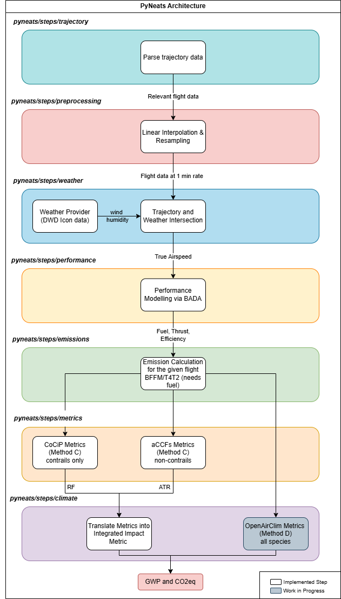
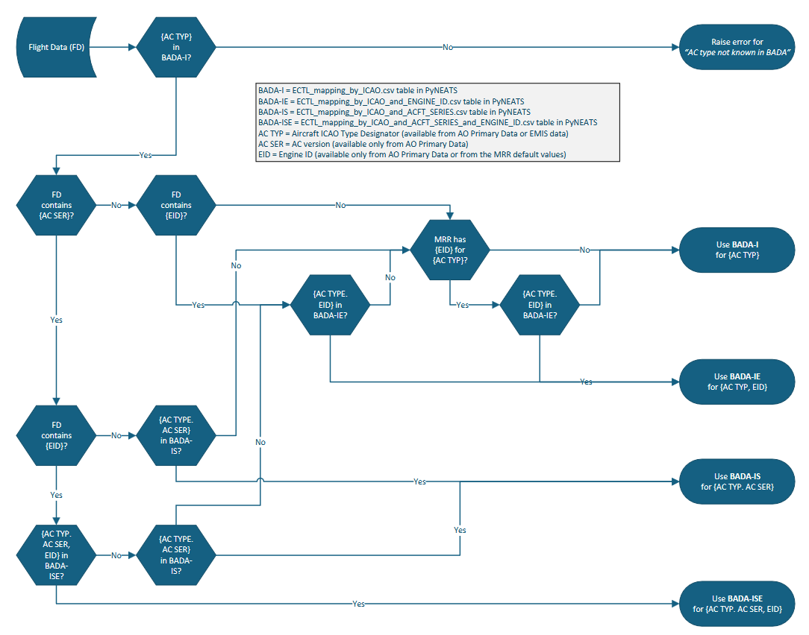

# General Presentation of PyNeats

PyNeats implements the computation pipeline defined in the *Reference set of technical specifications for the MRV*. This page describes the modules used to fulfil these requirements and documents the practical implementation choices made where the requirement document did not provide specific guidance.

!!! info "Terminology"

    Unfamiliar with AGWP, aCCF, CoCiP, SAC, FTFM/CTFM or similar terms? See the
    [Glossary](../glossary.md) (project-wide) and the [Abbreviations](#abbreviations)
    table at the bottom of this page (spec-specific).

---

## Architecture Overview

A **modular architecture** is used: functionalities are organised into isolated Python packages, each dedicated to a single and specific task. This design also enables easy comparison of, or switching to, alternative implementations in the future — e.g. different trajectory interpolators; reanalysis weather data instead of Numerical Weather Prediction (NWP); different aircraft performance models such as BADA or Poll–Schumann; emissions via DLR, PyContrails, or EUROCONTROL.

From a computational standpoint, PyNeats relies on external Python libraries to compute per-flight CO₂ equivalents (including non-CO₂ effects):

- **pyBADA** — aircraft performance computation
- **pyContrails** — CoCiP (contrails, Method C) and the pycontrails aCCF wrapper
- **aCCFs (non-CO₂ species other than contrails, Method C)** — two swappable implementations selectable via the step registry:
    - **`ACCFModel`** — delegates to the **CLIMaCCF** Python package (reference implementation from Yin/Dietmüller et al.)
    - **`LocalACCFModel`** — a local in-tree reimplementation of the aCCF v1.0A regressions, provided for computational efficiency and to remove the CLIMaCCF runtime dependency. Emulates CLIMaCCF numerically and is validated against it.
- **OpenAirClim** — Method D (small emitters)

!!! info "aCCF terminology"

    The terms **aCCF**, **CLIMaCCF** and **climaccf** are not interchangeable:

    - **aCCF** — *algorithmic Climate Change Function*: a family of regression formulas (scientific concept).
    - **CLIMaCCF** — the original reference library implementing aCCFs (Yin, Dietmüller et al.).
    - **climaccf** — the Python package name on PyPI that packages CLIMaCCF.
    - **ACCFModel** / **LocalACCFModel** — PyNeats step classes; the first wraps `climaccf`, the second is a local reimplementation.

All versions of each external library are documented in PyNeats and in the [NEATS User Group](https://eurocontrol.sharepoint.com/sites/coll-NEATSUserGroup) SharePoint.

Because of its modular design, PyNeats does not always use the highest-level abstractions of its upstream libraries. Nevertheless, it consistently builds on their established numerical utilities (primarily from PyContrails). **PyNeats introduces no new low-level numerical kernels.**

---

## 1. Modules Description

### 1.1 Trajectory Parsing

Retrieves the 4D flight trajectory and flight-level information from primary or secondary sources (e.g. **OFP, QAR, or FTFM/RTFM/CTFM** trajectories).

### 1.2 Interpolation / Resampling

Reconstructs the 4D trajectory to meet the **60-second sampling** requirement used by the CoCiP model for contrail-impact modelling.

### 1.3 Weather

Retrieves atmospheric data from **DWD's ICON NWP model** and provides:

- Wind fields for the performance module.
- All atmospheric variables required by the climate-effect models.

### 1.4 Performance (currently using BADA)

- Computes **fuel flow** and **aircraft mass** at each point along the trajectory when not provided by the AO in the primary data.
- Derives **thrust** and **engine efficiency** needed by CoCiP when not provided in the primary data.

### 1.5 Emissions

- Computes **emission indices and numbers** (vPM and nvPM).
- Supports relevant emissions models (**BFFM2**, **T4/T2**, …).
- Accounts for fuel properties.

### 1.6 Climate Effect Models

Uses trajectory, emissions, performance and weather data to compute per-flight climate effects of CO₂ and non-CO₂:

- **CoCiP** — contrail-induced cirrus cloudiness (Method C).
- **aCCFs** — other non-CO₂ species (Method C), including NOₓ and H₂O.
- **AirClim** — all non-CO₂ effects, for use **only by small emitters** (Method D).

### 1.7 Climate Metrics

Converts outputs of the climate-effect models into the requested non-CO₂ aviation-effects metrics (e.g. **GWP** and **CO₂-equivalent**) using the appropriate conversion factors.

---

## 2. Modules Dependencies

The following graph illustrates the dependency between the input(s) and output(s) of the different modules. The computational logic is **almost perfectly sequential** and implemented as such in PyNeats.

{ width="100%" }

*Figure 1 — Modules Dependencies*

---

## 3. Design Choices

This section details, for each module, the practical implementation / design choices that have been made. Choices made **outside the requirement document** or outside the nominal use of the standard libraries (PyContrails in particular) are highlighted *in italics*. Most of these choices have been discussed and coordinated with the authors of the requirement document from DLR.

### 3.1 Trajectories

Two trajectory types are used as **secondary data** when the AO does not provide the trajectory for a flight: EUROCONTROL's **FTFM/RTFM** and **CTFM**.

#### FTFM / RTFM (4D)

- The trajectory is produced by applying a 4D trajectory predictor (BADA-based) to the trajectory defined in the flight plan submitted to EUROCONTROL (**FTFM**), or to its regulated version (**RTFM** — FTFM translated in time by the delay resulting from the regulation).
- FTFM/RTFM are designed primarily for **capacity management**, so the data are **not optimised for performance modelling**.
- Sampling is relatively coarse (≈ 1 point per 5 minutes on average), which can introduce issues when applying interpolation and performance models.

#### CTFM (4D)

- Obtained by reconciling the original FTFM/RTFM with **post-flight surveillance data** (ADS-B, radar), applying adjustments when predefined difference thresholds are exceeded.
- The result is an updated and possibly enriched trajectory — typically closer to reality than the initial FTFM/RTFM, but **not as accurate as ADS-B or QAR**.
- Sampling is denser than FTFM/RTFM but still relatively coarse, with similar caveats for interpolation and performance modelling.

### 3.2 Preprocessing / Interpolation / Reconstruction

The interpolation module converts the input trajectory (primary or secondary) to the **60-second** sampling cadence required by the CoCiP climate-function module.

*PyNeats currently uses straightforward linear interpolation via PyContrails' `resample_and_fill` method. For secondary data, the coarse native sampling can yield segments that are not fully realistic and may stray outside the flight envelope after interpolation. To obtain more realistic trajectories, smoothing is applied to ground speed using the **Savitzky–Golay filter** from PyContrails, reducing the number of segments that fall outside the flight envelope.*

For optional primary variables along the trajectory (true airspeed, aircraft mass, fuel flow and engine efficiency), **linear interpolation** in time is applied to align their values with the resampled timestamps. An empty value is skipped, as if the AO had not sent that point: each resampled point is interpolated between the nearest points that have a value, and before the first or after the last point with a value it takes that nearest value. A variable with no value at any point is treated as not provided. Empty values are not filled from BADA.

### 3.3 Weather

#### 3.3.1 Weather Provider — DWD ICON mapping

DWD ICON variables covering the **550–140 hPa** range (FL160–FL460) **at an interval of 10 FL** are mapped into PyContrails objects according to the following dictionaries.

**`required_map`** (in CoCiP sense):

| DWD variable | PyContrails object |
|---|---|
| `u` | `EastwardWind` |
| `v` | `NorthwardWind` |
| `omega` | `VerticalVelocity` |
| `temp` | `AirTemperature` |
| `qv` | `SpecificHumidity` |
| `qi` | `MassFractionOfCloudIceInAir` |

**`optional_map`** (in CoCiP sense):

| DWD variable | PyContrails object |
|---|---|
| `geopot` | `Geopotential` |
| `clc` | `CloudAreaFractionInAtmosphereLayer` |
| `rhi` | `RelativeHumidity` |
| `pv` | `PotentialVorticity` |

**`rad_map`**:

| DWD variable | PyContrails object |
|---|---|
| `tsr` | `TOANetDownwardShortwaveFlux` |
| `olr` | `TOAOutgoingLongwaveFlux` |
| `sdr` | `SurfaceSolarDownwardRadiation` |

#### 3.3.2 Trajectory and Weather Intersection

Performance models such as BADA require **true airspeed (TAS)** to estimate aircraft performance over most of the flight. TAS can be computed from ambient wind (direction and magnitude), ground speed, heading, and track. To support this, DWD was asked to supply an **additional wind-field dataset** for **840–570 hPa (FL050–FL150)**, complementing the main file (550–140 hPa, ≈ FL160–FL460) that already provides atmospheric variables at higher altitudes.

- Both wind datasets are **concatenated**, and below FL050 the wind is set to **zero**, simplifying TAS derivation in the lower atmosphere.
- **Temperature**: interpolated on the main file (550–140 hPa) to provide BADA with the required temperature-based correction relative to the standard atmosphere. Extrapolation for lower altitudes is performed in the performance module (see §3.4).
- **Specific humidity**: interpolated on the main file (550–140 hPa) to supply the emission model for further use in CoCiP.

To compute the intersection more efficiently (using `intersect_met`), the weather data is first sub-sampled using `downselect_met` in PyContrails.

### 3.4 Performance Model

The emissions and climate modules require the following aircraft-performance values at each point along the trajectory, in addition to the timestamped position:

- **Fuel flow**
- **Engine efficiency**

The performance model is used to estimate these values when the AO does not provide them. A quantity is taken from the AO when at least one point has a value; points the AO leaves empty are not estimated by the performance model: they are interpolated in time between the nearest points with a value, or take that nearest value before the first or after the last point with a value (see §3.2 and Input Decision Logic).

**BADA** is the current chosen model for performance computation in PyNeats, in its open-source version from EUROCONTROL (**pyBADA**). BADA requires, at a given point of the trajectory:

- **True Airspeed (TAS)**
- **Aircraft mass**

#### Basic Parameterisation

- If TAS is not provided by the AO, it is computed from the (smoothed) ground speed and the wind fields, available **above 840 hPa (FL050)**; where no wind is available (below that level) the wind is set to 0, so TAS equals the smoothed ground speed. Implausible TAS values (provided or computed) are replaced before BADA is run (see rule 4 of the Input Decision Logic).
- The International Standard Atmosphere is corrected with actual air above 550 hPa, backfilling and forward-filling the correction for lower altitudes.
- BADA flight phases are determined from **vertical speed** using simple decision thresholds.

#### Input Decision Logic

Each performance quantity has its own source, so the cases below are not exclusive (an AO fuel flow can be combined with a BADA aircraft mass); the source of one quantity can still depend on what else is provided, as rules 2 and 4 show:

1. **BADA mapping:** every flight needs its aircraft type in the BADA mapping, even when the AO provides all performance data. The BADA file gives the wingspan (contrails); the mapping gives the number of engines (emissions; read from the BADA file when no BADA calculation is made) and, when no engine is declared, the engine UID (the MRR conservative engine where the type has one, otherwise the engine of the mapping row). A type not in the mapping makes the flight fail.
2. **Fuel flow, engine efficiency and aircraft mass all provided:** no BADA thrust or fuel-flow calculation; the provided values are used directly downstream. The fuel-burn plausibility check (total fuel burn at most 1.2 × (MTOW − OEW), applied on every other path with the fuel flow actually used; a flight it rejects is retried with BADA 3 and then, when it has points below FL20, without those points; it fails only if every attempt is rejected) also applies on this path, but a flight it rejects here fails at once, without retries, because every retry would use the same AO fuel flow. The same holds when the AO provides fuel flow but no aircraft mass (rule 3), where the check runs on the AO fuel flow before the mass is decreased with it. A fuel flow sent in kg/h instead of kg/s is caught this way.
3. **Otherwise BADA computes thrust and fuel flow at each point**, with the aircraft mass taken from, in order: the AO aircraft mass, if provided; else the AO take-off weight (TOW), decreased along the trajectory with the AO fuel flow if provided, else with the BADA fuel flow; else the estimate of rule 5, decreased in the same way.
4. **Outputs:**
    - **Fuel flow:** AO fuel flow (kg/s) if provided; else, if the AO provides aircraft mass, the mass decrease from each point to the next point divided by the time between the two points (set to 0 where the mass increases; empty at the last point, which has no next point); else the BADA fuel flow. The fuel burn of each segment is this fuel flow times the segment duration, so when the mass never increases the total fuel burn equals the mass at the first point minus the mass at the last point of the trajectory used: the 60 s resampled trajectory, without the points below FL20 when that retry is used. These masses are interpolated from the AO masses (see §3.2). The resampled points are the whole minutes from the first to the last AO time, so when the first or last AO time is not on a whole minute, the mass decrease before the first whole minute or after the last whole minute is not counted.
    - **Engine efficiency:** AO value if provided; else computed from BADA thrust and BADA fuel flow. This also holds when the AO provides fuel flow: **engine efficiency requires thrust AND fuel flow** from a consistent source, so engine efficiency = f(BADA thrust, BADA fuel flow), while the AO fuel flow is used downstream.
    - **Aircraft mass:** as in rule 3. When the AO provides fuel flow but no aircraft mass, the mass decreases with the AO fuel flow (from the AO TOW, or from the TOW of rule 5 estimated with the AO trip fuel), so the mass decrease from the first to the last point equals the reported fuel burn. A point with no AO fuel flow counts as no fuel burnt, as in the reported fuel burn; a mass ending below OEW is kept and logged as a warning. BADA computes thrust and its own fuel flow (for the engine efficiency) at this mass.

    A quantity counts as provided when at least one point has a value; points left empty are not filled from BADA: they are interpolated in time between the nearest points with a value, or take that nearest value before the first or after the last point with a value (see §3.2).

    Before any of these rules, also on the path of rule 2, a true airspeed is untrusted when it is missing (only a computed true airspeed can be missing here: empty AO values were already interpolated at the resampling, see §3.2), when its calibrated airspeed is below the BADA stall speed (at MTOW, take-off configuration by default) or above the BADA maximum operating speed (VMO, no margin; 400 kt when the BADA model gives none), or when its Mach number is 1 or more. No point is removed: an untrusted true airspeed is replaced by linear interpolation in time between the nearest trusted points; before the first and after the last trusted point it takes the calibrated airspeed of that point, converted to true airspeed at its own altitude. The acceleration is recomputed. A computed true airspeed is checked and replaced on the 1-minute speed before smoothing, then smoothed with the same 7-point filter; the smoothed value is used at the replaced points (not before the first or after the last trusted point, which keep the calibrated airspeed of that point) and at the points within the smoothing window of a replaced point (up to 3 points away; also the first 3 points of the flight when one of its first 7 points is replaced, and the 3 points before the last point when one of the 7 points before the last point is replaced), which can change too. All other points keep their true airspeed; a flight with an AO true airspeed and no untrusted point keeps it at every point. A computed true airspeed has no value at the last point, which has no next point: that point is always untrusted and takes the value of the point before it, but it does not cause the points before it to be re-smoothed. The output `true_airspeed` is the value after this step. A flight fails, with no retry, when more than 80 % of its time is untrusted, when no point is trusted, or when the check itself fails. On the path of rule 2 (BADA fuel flow not used), only a failure of the check itself fails the flight: in the other two cases the flight is kept with its true airspeed replaced (or kept as is when no point is trusted).

5. **Neither mass nor TOW provided:** the load factor is used (AO-provided or conservative default of 1; an AO value above 1 is set to 1 with a warning, a negative value fails the flight at parsing). When the AO provides fuel flow, the trip fuel is the AO fuel burn and no iteration is needed: $TOW = \min \bigl(MTOW,\; OEW + \text{load\_factor} \times MPL + 1.15 \times \text{AO trip fuel}\bigr)$, and the mass decreases along the trajectory with the AO fuel flow. Without AO fuel flow, the following approach (similar to PyContrails) is applied:

    1. **Initial estimate** (constant along the trajectory):

        $$\text{Aircraft mass} = OEW + \text{load\_factor} \times (MTOW - OEW)$$

        where OEW (operative empty weight) and MTOW (maximum take-off mass) are obtained from BADA.

    2. **First performance calculation:** compute fuel flow and fuel burn at each trajectory point from this mass.

    3. **Fuel-reserve estimation:** the required reserve is **15 % of trip fuel** (`fuel_reserve_fraction`, following Teoh et al., 2024).

    4. **Updated TOW:**

        $$TOW = \min \bigl(MTOW,\; OEW + \text{load\_factor} \times MPL + \text{consumed\_fuel} + \text{reserve}\bigr)$$

        where MPL is the maximum payload and `consumed_fuel` is the total fuel burn estimated in step 2. Aircraft mass along the trajectory is then reduced according to fuel burnt.

        !!! note "MPL source"
            MPL is read from the BADA files (the OPF maximum payload for BADA 3). Only if a BADA file gives no MPL is $\text{MPL} = MTOW - OEW$ used.

    5. **Iteration:** steps 2–4 are repeated, with the mass along the trajectory now starting at the updated TOW, until the TOW changes by 1 % or less of the previous TOW (`max_rel_mass_diff`). Within one estimate, steps 2–4 run at least twice and at most four times (`max_mass_estimation_iter`); after the fourth time the result is kept even if the change is still above 1 %. A retry with BADA 3, or after points below FL20 are removed, starts the estimate again from step 1. The fuel flow, thrust and mass kept are those of the last BADA calculation, which started from the TOW of the previous update; the TOW computed after that calculation is used only for the convergence test.

See [Input Prioritization](input-prioritization.md) for the full decision flowchart.

#### Additional Parameters

- **Fuel calorific value (`q_fuel`):** BADA gives the fuel flow of a fuel with a lower calorific value of **43.217 MJ/kg** (the value declared in the BADA 4 aircraft files; the same value is used for BADA 3, which declares none). PyNEATS rescales it to the fuel actually used: `fuel flow = BADA fuel flow × 43.217 / q_fuel`, where `q_fuel` is the AO value, else the airport fuel file value, else the default 42.8 MJ/kg. The correction therefore always applies: with the default, BADA fuel flow is multiplied by 43.217 / 42.8 = 1.0097 (+0.97 %). A provided AO fuel flow is not rescaled.
- **ICAO ↔ BADA mapping:** the correspondence between ICAO aircraft types, aircraft versions, engine identifiers and BADA types (**BADA 4 in priority**, then **BADA 3**) is achieved following the decision tree in Figure 2.

{ width="100%" }

*Figure 2 — ICAO-BADA Correspondence*

### 3.5 Emissions Model

PyNeats uses the emission model within **PyContrails** that implements the **BFFM2** and **T4/T2** models.

To account for fuel properties provided by AOs, a **custom `NEATSFuel` class** has been designed specifically for NEATS. This class is passed to the initial PyContrails `Flight` object at the start of the computation and defines the following properties.

- The `NEATSFuel` class **inherits from `SAFBlend`** in CoCiP:
    - All fuel properties defined in `SAFBlend` are initially set identically in `NEATSFuel`.
    - If the AO provides a value for the **hydrogen content** fuel property (wt.%, percent by mass, e.g. 13.79), it overrides the initial `hydrogen_content` value.
    - If the AO has not provided hydrogen content but has provided the **hydrogen-to-carbon ratio ($r$, atomic: hydrogen atoms per carbon atom, MRR Annex IIIa §1(36))**, `hydrogen_content` (wt.%) is overridden by:

        $$\text{Hydrogen content [wt.\%]} = \frac{r \cdot 1.008}{12.011 + r \cdot 1.008} \times 100$$

    - If the AO provides the **calorific value**, it overrides the `q_fuel` conservative default of **42 800 000 J/kg**. If it does not, and an airport fuel file is configured, the value for the departure airport is used.
    - A supplied `q_fuel` must be in J/kg and between **35 and 50 MJ/kg**. Outside this range (typically a value in MJ/kg) the flight fails at parsing; a wrong value in the airport fuel file stops the run when the runner is built.
    - If **neither** hydrogen content **nor** hydrogen-to-carbon ratio is provided, the hydrogen content defaults to the conservative **13.79 wt.%**.
- The water emission index **`ei_h2o`** (initial default 1.23 in PyContrails/CoCiP) is **adjusted linearly** based on the hydrogen content value, in line with what is done in `SAFBlend`.
- The **nvPM** is reduced using the `black_carbon` class from PyContrails — as done in `SAFBlend` — taking the hydrogen content as parameter (currently only available for SAF in PyContrails).
- The **aromatic content, sulphur, and naphthalene** fuel properties, which an AO can provide, are **not used so far** in any calculation of the Emissions module.
- If **no engine** is provided by the AO, emission computations are performed using the **conservative engine** provided by the default table in the **MRR**.

### 3.6 Climate Functions

The parameterisation of the climate functions is specified precisely in the requirement document. Note however (as clarified by the consortium) that:

- The alteration of the calorific value (`q_fuel`) will have an impact on the **SAC** (Schmidt-Appleman Criterion) computation in CoCiP.
- It has been finally chosen **not to apply any humidity correction** to the ICON NWP data.
- As specified in the requirement document, **aCCF version `v1.0A`** is used.

### 3.7 Climate Metrics

The CO₂-equivalent computation is based on **GWP for three horizons: 20, 50, and 100 years**. The formulas used are detailed below.

#### 3.7.1 Method C

The **EAGWP** (Efficacy-adjusted Absolute Global Warming Potential) for Contrails at the time horizon $H$ is defined as:

$$
EAGWP_{Con}(H) = \frac{EF \cdot \varepsilon_{Con}}{S_{Earth} \cdot s_{yr}} \quad [W \cdot m^{-2} \cdot yr]
$$

where:

- $EF$ is the total contrail energy forcing from CoCiP (sum over all segments) $[J]$
- $\varepsilon_{Con} = 0.37$ is the **efficacy for contrails**, specified in the technical requirement document
- $S_{Earth} = 5.101 \cdot 10^{14}\ [m^2]$ is the Earth's surface
- $s_{yr} = 31\,536\,000$ : seconds per year

The **AGWP for CO₂** at the time horizon $H$ is obtained using AirClim values scaled by emitted mass:

$$
AGWP_{CO2}(H) = C(H) \cdot m_{CO2} \quad [W \cdot m^{-2} \cdot yr]
$$

where $C(H)$ are AGWP coefficients at horizon $H$ from AirClim:

| Horizon $H$ (y) | $C(H)$ |
|---|---|
| 20  | $24.16 \cdot 10^{-15}$ |
| 50  | $47.57 \cdot 10^{-15}$ |
| 100 | $74.36 \cdot 10^{-15}$ |

and $m_{CO2}$ is the total CO₂ emitted on the flight.

The **CO₂-equivalent of contrails** is therefore defined as:

$$
CO2_{eq,Con}(H) = \frac{EF \cdot \varepsilon_{Con}}{S_{Earth} \cdot C(H) \cdot s_{yr}} \quad [kg]
$$

The **EAGWP obtained for all non-contrails species** is obtained from aCCFs (v1.0a) by applying conversion factors as defined in *Dahlmann et al. (2025)*:

$$
EAGWP_{Spec}(H) =
\frac{K_{AGWP \leftarrow RF}^{Spec}(H)}{K_{ATR \leftarrow RF}^{Spec}(H_0)}
\cdot \frac{\varepsilon_{Spec}^{2}}{RF_{Spec}^{Backward}}
\cdot ATR^{Spec}(H_0) \quad [W \cdot m^{-2} \cdot yr]
$$

where:

- $K_{AGWP \leftarrow RF}^{Spec}(H)$ is the conversion factor from *Dahlmann et al. (2025)* that converts RF from pulse emissions to $AGWP(H)$ (cf. below).
- $K_{ATR \leftarrow RF}^{Spec}(H)$ is the conversion factor from *Dahlmann et al. (2025)* that converts RF from pulse emissions to $ATR(H)$ (cf. below). These conversion factors **include efficacy** for ATR calculation. It is therefore necessary to multiply the ATR values from the aCCFs with the efficacy to be consistent with the conversion factors. This translates into the **efficacy being squared** in the formula.
- $ATR^{Spec}(H_0)$ is the output from the aCCF with a pulse scenario and no efficacy parameterisation.
- $RF_{Spec}^{Backward}$ is the **RF backward calculation factor** used in aCCF v1.0 and v1.0a (*Yin et al., 2023; Dietmüller et al., 2023*) that needs to be **discounted** here as it is not consistent with factors from *Dahlmann et al. (2025)*:

    | Species | $RF_{Spec}^{Backward}$ |
    |---|---|
    | H₂O | 0.52 |
    | O₃ | 0.508 |
    | CH₄ | 0.492 |
    | PMO | 0.492 (CH₄ value: PMO is derived from the CH₄ aCCF) |

    A species without an RF backward factor, an efficacy or a conversion factor is an error; there is no default of 1.

- $H_0 = 20$ is the reference horizon for pulse computation within CLIMaCCF.
- $\varepsilon_{Spec}$ are the efficacies as defined in the specification document: CH₄ 1.04, O₃ 1.05, H₂O 1.0 and PMO 1.0 (the PMO value is the RSTS value, confirmed by the method owner on 2026-10-28). Values in `EFFICACY` in `pyneats.core.physics`.

**Primary-mode ozone (PMO).** PMO is the long-term decrease in O₃ that follows the NOx-driven decrease in CH₄. With `accf_kwargs["PMO"]` True (default), the local aCCF step writes a separate segment column

$$
ATR^{PMO}(H_0) = 0.29 \cdot ATR^{CH4}(H_0)
$$

(PMO/CH₄ RF ratio 0.29, `PMO_CH4_RF_RATIO`, as in CLIMaCCF and OpenAirClim); $ATR^{CH4}$ itself excludes PMO. $EAGWP_{PMO}(H)$ is computed with the formula above and the PMO values of $K_{AGWP \leftarrow RF}$, $K_{ATR \leftarrow RF}$, $\varepsilon$ and $RF^{Backward}$. The output keeps one `CH4` entry, which is **CH₄ including PMO**:

$$
EAGWP_{CH4\,incl.\,PMO}(H) = EAGWP_{CH4}(H) + EAGWP_{PMO}(H)
$$

The sum is taken before the non-CO₂/CO₂ plausibility check.

The conversion factors $K_{AGWP \leftarrow RF}$ and $K_{ATR \leftarrow RF}$ (Pulse 2025 scenario, from *Dahlmann et al., 2025*) used in PyNeats are:

**$K_{AGWP \leftarrow RF}^{Spec}(H)$** — RF → AGWP conversion (per species, per horizon):

| Horizon $H$ | CH₄ | O₃ | H₂O | PMO |
|---|---|---|---|---|
| 20  | 10.6318 | 1.0192 | 1.0192 | 10.6318 |
| 50  | 13.0968 | 1.0192 | 1.0192 | 13.0968 |
| 100 | 13.3563 | 1.0192 | 1.0192 | 13.3560 |

**$K_{ATR \leftarrow RF}^{Spec}(H)$** — RF → ATR conversion (includes efficacy):

| Horizon $H$ | CH₄ | O₃ | H₂O | PMO |
|---|---|---|---|---|
| 20  | 0.2838 | 0.0337 | 0.0320 | 0.2690 |
| 50  | 0.1898 | 0.0154 | 0.0146 | 0.1800 |
| 100 | 0.1059 | 0.0082 | 0.0078 | 0.1004 |

Source: *Dahlmann et al. (2025)*. Values defined in [`pyneats.core.physics`](https://github.com/eurocontrol-asu/PyNeats/blob/main/src/pyneats/core/physics.py) as `CONVERSION_FACTORS_AGWP_TO_RF` and `CONVERSION_FACTORS_ATR_TO_RF`.

The **CO₂-equivalent of other species** is therefore defined as:

$$
CO2_{eq,Spec}(H) = \frac{EAGWP_{Spec}(H)}{C(H)} \quad [kg]
$$

#### 3.7.2 Method D

While **OpenAirClim** is designed to compute climate trajectories associated with an emissions inventory, it can also perform a **stand-alone computation for a single flight** (the emission inventory reduces to the emissions of that flight), which is the configuration chosen for **Method D**.

For contrails, a **base inventory** must be provided so that the marginal contrail contribution can be estimated in addition to it. In PyNeats, the base inventory currently used is:

- **`ELK_aviation_2025_res5deg_flat.nc`** (DLR ELK aviation inventory v2.1, regridded to 5°; its `Inventory_Year` attribute is 2025)

**Reference year.** Every flight is computed as a pulse emitted in one reference year, `OPEN_AIRCLIM_REFERENCE_YEAR` in `neats_default_parameters.py` (2025), whatever the flight date. The emission inventory year, the start of the metric window ($t_0$) and the simulated period (reference year to reference year + 100) all use it, so the same flight gives the same result in any calendar year. The reference year must be covered by the base inventory. Changing it changes the background concentrations OpenAirClim uses, and therefore the results.

The OpenAirClim library directly outputs the global warming potential for each species ($AGWP_{Spec}(H)$) **without including the efficacy term**. Including the efficacy term provides:

$$
EAGWP_{Spec}(H) = AGWP_{Spec}(H) \cdot \varepsilon_{Spec}
$$

OpenAirClim gives PMO as a separate species. PyNEATS keeps it apart, applies the PMO efficacy, and adds it into the `CH4` entry (**CH₄ including PMO**), before the non-CO₂/CO₂ plausibility check:

$$
EAGWP_{CH4\,incl.\,PMO}(H) = AGWP_{CH4}(H) \cdot \varepsilon_{CH4} + AGWP_{PMO}(H) \cdot \varepsilon_{PMO}
$$

And finally, the CO₂-equivalent:

$$
CO2_{eq,Spec}(H) = \frac{EAGWP_{Spec}(H)}{C(H)} \quad [kg]
$$

---

## Abbreviations

| Term | Definition |
|---|---|
| aCCF | algorithmic Climate Change Function — family of regression formulas |
| CLIMaCCF | Reference library implementing aCCFs (Yin, Dietmüller et al.) |
| climaccf | Python package name on PyPI that packages CLIMaCCF |
| AGWP | Absolute Global Warming Potential |
| AO | Aircraft Operator |
| ATR | Average Temperature Response |
| BADA | Base of Aircraft Data (EUROCONTROL) |
| CoCiP | Contrail Cirrus Prediction model |
| CO2e | CO₂-equivalent |
| CTFM | Current Tactical Flight Model |
| EAGWP | Efficacy-adjusted AGWP |
| EF | Energy Forcing |
| FTFM | Filed Tactical Flight Model |
| GWP | Global Warming Potential |
| MPL | Maximum Payload |
| MRR | Monitoring, Reporting and Regulation (default engine table) |
| MRV | Monitoring, Reporting, Verification |
| MTOW | Maximum Take-Off Weight |
| NWP | Numerical Weather Prediction |
| OEW | Operating Empty Weight |
| OFP | Operational Flight Plan |
| QAR | Quick Access Recorder |
| RF | Radiative Forcing |
| RTFM | Regulated Tactical Flight Model |
| SAC | Schmidt-Appleman Criterion |
| TAS | True Airspeed |
| TOW | Take-Off Weight |
